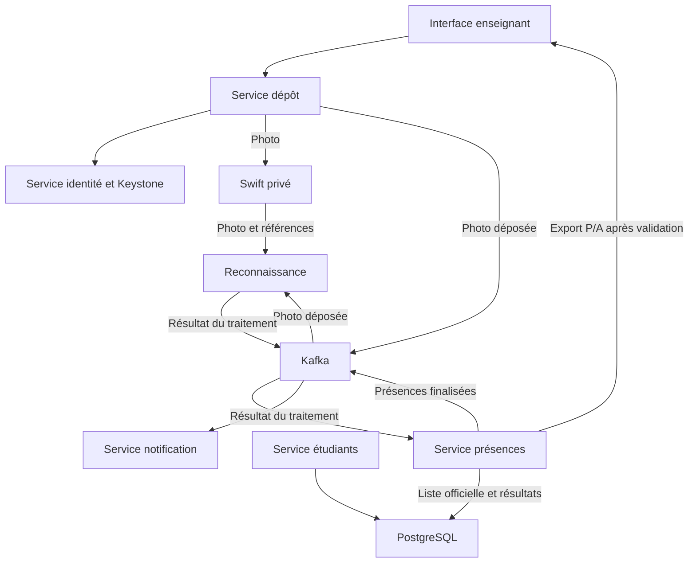

# Architecture du mini-projet Cloud
## Gestion des présences sur OpenStack DevStack

Le système traite une photo de séance, compare les identifiants reconnus à la liste officielle et prépare un export P/A. Le prototype local de comparaison P/A sur identifiants fictifs sera ajouté au dépôt dans un prochain commit. Le flux photo, les intégrations distribuées et le déploiement DevStack sont les étapes suivantes.

## Flux métier et frontières

1. Le service de dépôt vérifie l’identité, le rôle et l’accès de l’enseignant à la séance. Il valide le fichier et écrit l’objet dans Swift sous une clé générée.
2. Il enregistre la référence de l’objet et le traitement à démarrer dans PostgreSQL. La publication de `photo.uploaded` utilise une boîte d’envoi transactionnelle pour reprendre après une panne du broker. Si l’écriture des métadonnées échoue après l’envoi à Swift, un nettoyage supprime l’objet orphelin à l’expiration.
3. Une instance du service de reconnaissance lit la photo et les références dans Swift. Elle publie `recognition.completed` avec les identifiants candidats, les scores et l’état du traitement. Un échec publie `recognition.failed` et laisse la séance à vérifier.
4. Le service de présences compare le résultat à la version de la liste officielle associée à la séance. Les candidats hors liste sont ignorés. Les correspondances incertaines passent en revue. L’enseignant valide le résultat avant l’export et la notification.

| Événement | Données principales | Clé de partition recommandée |
|---|---|---|
| `photo.uploaded` | `eventId`, `sessionId`, `photoId`, `swiftObjectKey` | `sessionId` |
| `recognition.completed` | `eventId`, `sessionId`, `photoId`, `modelVersion`, identifiants et scores | `sessionId` |
| `recognition.failed` | `eventId`, `sessionId`, `photoId`, raison technique générique | `sessionId` |
| `attendance.finalized` | `eventId`, `sessionId`, version de l’export | `sessionId` |

Les événements portent un identifiant de corrélation et une version de schéma. Les consommateurs enregistrent les `eventId` traités. Une relivraison ne génère ni doublon de présence ni seconde notification. La base impose une contrainte unique par paire `sessionId, studentId`. Les photos et les modèles restent hors des messages Kafka et du dépôt Git.

## Implantation DevStack

| Couche | Composants | Rôle |
|---|---|---|
| IaaS | Nova, Neutron, Glance, Swift et Keystone | VM, réseau privé, images de VM, stockage objet et identité. |
| Orchestration IaaS | Heat | Décrire les VM et leur réseau. Terraform gère le conteneur Swift de démonstration dans un périmètre distinct pour éviter deux propriétaires de la même ressource. |
| Plateforme opérée par le groupe | Kubernetes, Kafka, PostgreSQL | Exécuter les conteneurs Docker, découpler les traitements et conserver les données structurées. Cette couche fournit des services internes de type PaaS. |
| Application | Identité, étudiants, dépôt, reconnaissance, présences, notification et interface | Fournir la gestion des présences comme service applicatif aux enseignants. |

Sur Kubernetes, le service de reconnaissance consomme Kafka en groupe. Le dimensionnement tient compte du nombre de partitions, de la mémoire du modèle et du débit de traitement. Mesurer le retard Kafka et le temps de traitement avant de fixer une cible d’autoscaling. Un autoscaler utilisant le retard nécessite une source de métriques externes configurée. Docker et Kubernetes définissent l’exécution applicative. Heat orchestre l’infrastructure OpenStack. Le pipeline CI/CD compile, teste, construit les images et déploie sur un environnement DevStack autorisé.

La démo mono-nœud peut valider le flux. Une topologie haute disponibilité demande plusieurs domaines de panne, des réplicas de services, de Kafka et de PostgreSQL, ainsi que des tests de panne et de reprise. La charge est bornée par la taille des photos, les quotas, le nombre maximal de workers et les règles de rétention Swift. À mesurer en TP avant de présenter un résultat de performance.

## Données, accès et observabilité

- PostgreSQL conserve inscriptions, versions de listes, séances, présences, audit et références des objets. Swift conserve les photos privées avec accès restreint, chiffrement et durée de conservation définis pour l’environnement.
- Les secrets sont fournis au déploiement. Les journaux utilisent identifiants techniques et codes d’erreur. Les tableaux de bord suivent le retard Kafka, la latence de reconnaissance, les échecs et le nombre de dossiers à revoir.
- La démo utilise des identifiants et données de test. L’utilisation de données biométriques réelles dépend de la procédure validée par l’établissement. Prévoir une méthode manuelle pour les correspondances incertaines et la gestion des données.
- Le modèle de reconnaissance sera choisi après vérification de sa licence et de son adéquation, puis épinglé par identifiant et version dans la configuration quand l’intégration sera testée.

## Jalons et vérification

| Jalon | Vérification |
|---|---|
| 1. Comparaison P/A | E02 et E03 ressortent P. E01 ressort A. E99, hors liste, n’est pas exporté. |
| 2. Persistance et objets | La liste officielle est versionnée en PostgreSQL. Une photo de démo est privée dans Swift. PostgreSQL conserve sa référence. |
| 3. Traitement asynchrone | Les messages déclenchent la reconnaissance et alimentent la revue. Rejouer le même événement produit un seul résultat. Une panne laisse le traitement en attente. |
| 4. Déploiement | Démarrer sur DevStack, injecter les secrets, vérifier l’accès aux services et enregistrer une exécution CI/CD. |
| 5. Soutenance | Tester le parcours en présentiel, préparer la vidéo de dix minutes et le PowerPoint, et joindre la documentation d’utilisation, les justificatifs et les prompts réellement utilisés. |

Sources techniques. [DevStack](https://docs.openstack.org/devstack/latest/configuration.html) · [Autoscaling Kubernetes](https://kubernetes.io/docs/tasks/run-application/horizontal-pod-autoscale/).
